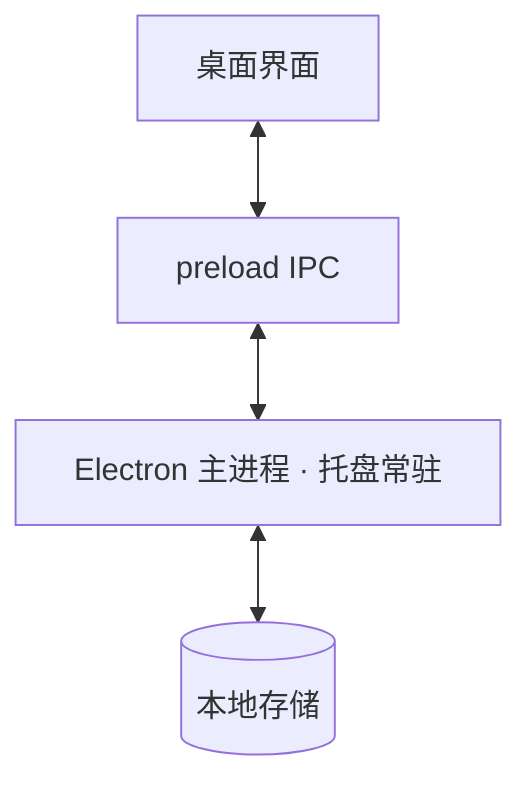
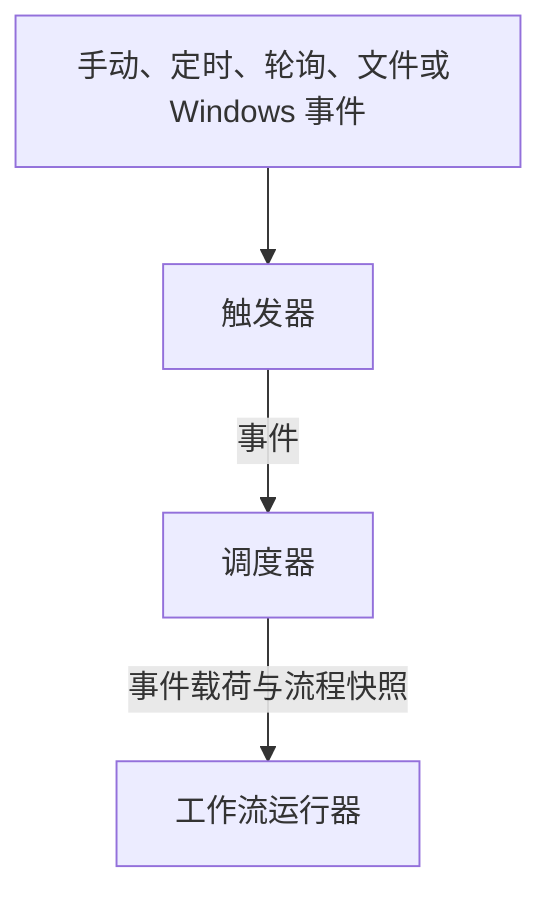
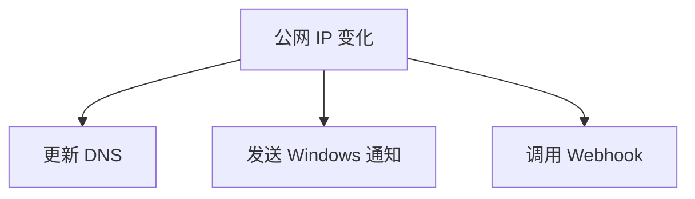
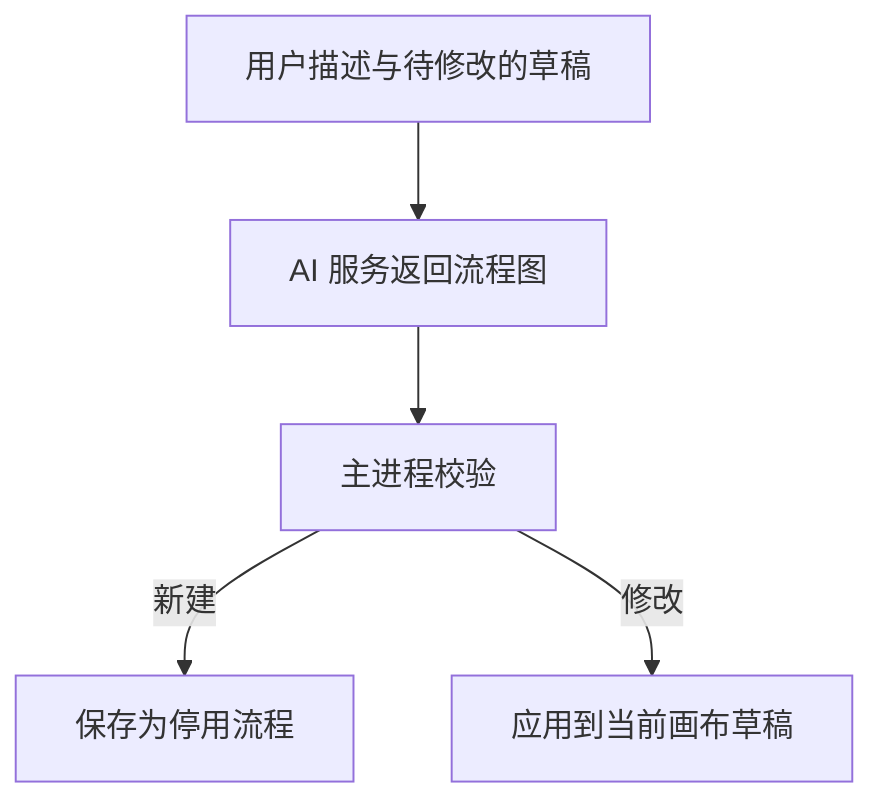
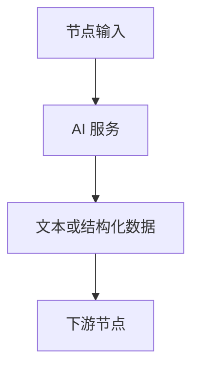

# KHooks 整体架构

KHooks 是以本机事件为入口的桌面自动化工具。用户在画布上手动编排流程，或由 AI 生成草稿，再通过触发器、条件和动作节点响应事件。任务在本机执行，用户可以从运行记录追踪实际经过的路径和节点结果。

## 子系统与数据流

关掉窗口后，Electron 主进程通过系统托盘继续运行。渲染进程负责编辑、启停、手动运行和查看记录，通过 preload IPC 访问主进程。主进程校验来自界面的操作，管理流程定义、触发器生命周期、任务执行和本地数据。

总图展示桌面界面、后台进程和本地存储之间的关系。[当前实现](#当前实现)记录已交付的能力。

## 触发与调度

触发器负责判断事件是否发生，并提交包含来源、类型和载荷的事件。调度器按目标工作流及其忙碌策略接收事件，为任务绑定原始载荷和当时的工作流快照。运行器从快照中的触发节点开始，将事件载荷作为该节点的输出。新增本机事件源沿用这一入口，例如将文件变化转换成可供下游引用的事件字段。

每条流程可选择忙碌策略。旧流程默认跳过。同一工作流最多有一次活跃运行，工作流内的节点并行由运行器管理。

| 忙碌策略 | 新事件到达 | 应用重启 |
| --- | --- | --- |
| 忙碌跳过 | 跳过自动事件，手动运行提示忙碌。轮询仍更新变化基线。 | 恢复触发器调度。中断的运行保留记录。 |
| 持久排队 | 按接收顺序持久入队，同一工作流串行取用。每条流程的队列最多保留 50 条待处理任务，达到上限后自动事件丢弃、手动运行提示已达上限。 | 用原事件和流程快照从触发器重跑因退出而中断的任务，记录为同一任务的新尝试，再处理后续排队任务。 |
| 中断并运行最新事件 | 请求取消当前运行、后续节点和重试。收尾期间只在当前会话保留最新事件，当前运行退出后再启动它。 | 恢复触发器调度。中断的运行保留记录，等待中的事件随会话结束而丢弃。 |

已发出的外部动作可能在取消后完成。排队模式重跑时，已经发出的 HTTP 请求或通知也可能再次执行。持久队列覆盖应用已经接收的事件，应用退出期间能否补收事件取决于事件来源。

- 定时触发器支持固定间隔和按系统当地时间每天／每周运行。应用休眠或退出时错过的时刻跳过，同一当地日期与时刻只触发一次。
- 公网 IP 和通用 HTTP 轮询各自保留最近一次成功采纳的基线。通用轮询比较完整响应或单个 JSONPath 值。修改请求和字段提取配置时重置对应基线。轮询变化与持久入队在同一次存储提交中完成。
- 文件监听在运行会话内观察单个文件或目录直接子项，合并同一路径的连续事件。首次扫描建立基线，重命名视为删除和新增。
- Windows 辅助程序通过标准输出向主进程报告媒体会话播放状态、系统网络连接与屏幕电源状态的变化。辅助程序只在有订阅时运行，以独立原生二进制随安装包分发。开发环境通过 `vp run build:windows-events` 单独准备辅助程序。

## 工作流执行

- 可运行的工作流从唯一触发器出发，其余节点各有一个入口，且都能从触发器到达。连线禁止形成环路。单个出口的分支数以及工作流的节点数、连线数均无固定上限。
- 普通节点和触发器的出口会并行启动所有相连的下游节点。条件节点只启动命中出口的全部分支。公网 IP 变化产生一次运行，所有分支都可按节点标识引用该次触发携带的 IP 数据。
- 每次运行使用自己的流程快照和节点输出。分支中的节点可以引用本路径上的上游输出。运行记录保存实际执行的节点和经过的连线，正常运行会等所有已启动的分支结束后标记为成功。
- 处理节点可配置固定间隔重试和失败出口。重试耗尽后，连接到失败出口的后续节点可引用错误信息。未处理的失败使运行停止调度后续节点并收尾已启动的动作。运行状态区分失败、被新事件取消和因应用退出而中断，排队恢复针对应用退出。
- HTTP 响应、文件内容和模型输出可供本次运行的下游节点引用。节点历史记录为这些原始结果保存状态或元数据。设置数据提供类型转换和字段映射，条件分支可按全部或任一规则匹配。
- 本地文件节点处理完整的 UTF-8 文本或 JSON 内容，应用层不限制单个文件的大小。读取结果在本次运行内保留，供下游节点引用。

## 工作流编辑与复用

- 主进程工作流服务统一处理编辑器保存、AI 生成草稿和本地 CLI 导入。AI 新建和 CLI 导入使用相同的工作流图，校验通过后生成独立流程，默认停用。导入成功后列表立即更新，编辑器保留未保存的修改，用户可显式重新加载最新的已保存版本。
- 命令行脚本通过仅在本机回环地址监听的服务，向正在运行的实例导入或查询工作流。Windows 安装版使用 Electron 内置的 Node.js 执行同一脚本，开发时也可用独立 Node.js 执行。每个数据目录对应独立连接信息和当次启动令牌。CLI 可显式启用新流程，存储文件仍在应用启动时加载。
- 触发器和处理节点可设置自定义名称。画布展示名称和节点类型，名称留空时标题显示节点类型。节点身份和字段引用由工作流图内的节点标识决定。
- 支持上游变量的输入字段可输入 `@` 或 `＠` 选择当前路径的上游输出。编辑器用变量标签展示绑定，模板以 `@{节点ID.字段}` 保存，条件分支的上游字段保存单个路径。JSON 字符串值仅包含一个引用时，执行时保留上游数据的原始类型。
- 从流程列表复制时，用户可在弹窗中修改默认副本名称，确认后创建独立的停用流程。副本保留节点、布局、连线和图内标识，触发器状态与运行记录按新流程独立管理。
- 流程列表和编辑器都可启用或停用流程。启用前由主进程校验已保存的配置是否可运行。
- 流程列表可手动运行已配置触发器的流程，启用和停用的流程均使用已保存的配置。
- 已保存流程的手动运行遵循忙碌策略。编辑器可在停用时试跑草稿，草稿仅在本次会话执行，试跑不会更新自动触发基线。文件和系统事件的手动运行使用标记为手动的载荷。
- 启用中的流程可直接编辑并保存。保存时校验流程是否可运行，后续接收的事件采用新配置，已接受的持久任务继续使用原快照。停用停止自动事件并暂停原有队列，停用后显式提交的手动任务仍可运行。触发器配置变更后更新调度，仅变更流程名称、布局或处理节点时沿用原调度。
- 画布右键菜单可删除所选节点和连线，多选时可批量删除。删除整条流程前需先停用，列表中确认一次即可删除。
- 用户可从单个节点的右键菜单将配置另存到本地组件库，供各流程复用。组件保存配置快照，添加时以组件名称和新的节点标识创建独立节点。上游字段绑定在添加时清除，由用户连线后重新选择。触发器组件遵循每条流程最多一个触发器的规则。

## 本地状态与运行记录

本地存储管理工作流定义、触发器状态、排队任务及运行记录。持久入队及任务状态变更具有事务边界。任务从待运行转为执行中时，在同一事务内关联新的运行尝试。任务保留原始事件和流程快照，供重启时恢复。

本地存储升级到版本 2 时，一次性转换工作流、组件、排队任务和运行快照里的旧变量模板，并原子写回。

运行记录关联逻辑任务、运行尝试和用于追踪的流程快照，展示触发来源、经过的路径、各步骤的执行时间、尝试次数、节点结果和失败原因。持久任务恢复时沿用原触发来源。历史详情使用该次运行的快照展示，编辑后的工作流定义只影响后续接收的任务。

Windows 通知记录变量替换后提交给系统的完整标题和正文，提交失败也保留已渲染的内容。HTTP 历史记录保留目标主机、响应状态等诊断信息。文件读写和模型节点记录目标及格式等元数据。节点使用的请求头、URL 查询参数、HTTP 正文、文件正文及模型提示词和响应正文不直接写入节点历史。

## AI 编排与执行

### 编排助手

列表页的 AI 生成将用户描述和节点约定发给已配置的 AI 服务，主进程校验返回的流程图并保存为停用流程。详情页的 AI 修改同时发送当前草稿的流程名称、节点配置和连线，包含尚未保存的编辑。校验成功后在当前画布应用结果，保留流程的标识、启用状态和忙碌策略，由用户审核后保存。

### AI 节点

AI 节点由用户在流程中显式配置模型和输入。节点运行时向所选服务发送配置指定的输入，返回文本或结构化数据，作为该节点的输出。后续动作由图上的连线和节点配置决定。

## 当前实现

| 能力 | 当前行为 |
| --- | --- |
| 后台触发 | 关窗后通过托盘继续运行。触发器和忙碌策略见[触发与调度](#触发与调度)。已保存公网 IP 流程的手动运行也会更新采纳的 IPv4。移除已下线站点后，若流程没有剩余查询站点，会自动停用。 |
| 流程图 | 按[工作流执行](#工作流执行)规则运行。节点可以设置数据、条件分支、延时、发出 HTTP 请求或 Windows 通知、读写本地文件和调用模型。 |
| 本地数据与记录 | 用户数据目录中的 JSON 文件通过串行原子写入保存流程、组件、触发器状态、持久任务、设置和运行记录。运行详情按执行时的快照显示路径和尝试次数。 |
| AI | 配置 OpenAI 兼容服务后，可以生成停用草稿、修改当前草稿，也可在流程中调用模型。AI 服务密钥由主进程通过 Electron `safeStorage` 加密保存。 |
| 应用更新 | Windows 安装版从 GitHub 正式 Release 检查更新，默认开启启动及每小时后台定时检查与自动预下载（可在设置页开关）。预下载完成后发送 Windows 通知，点击通知跳转至设置页；点击立即更新时显示下载百分比与计时，并弹出 NSIS 一键安装进度条窗口，安装完成后自动重启应用。 |
| 应用图标 | 开发版的窗口、系统托盘和 Windows 运行时图标带红色 DEV 标记。安装版使用正式图标。 |

现有行为见[工作流规则](../../src/shared/workflow.ts)、[主进程入口](../../src/main/index.ts)、[运行器](../../src/main/engine.ts)和[本地存储](../../src/main/storage.ts)。
