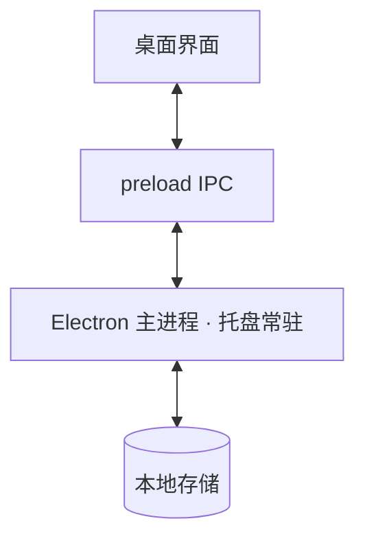
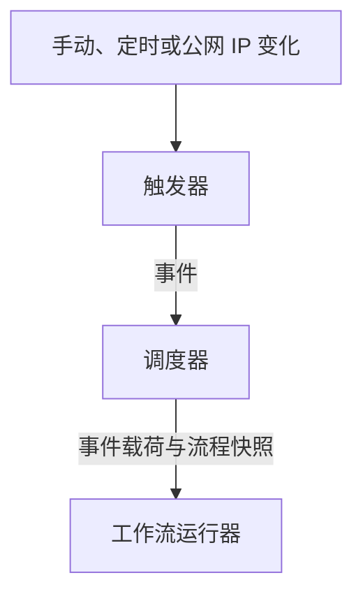
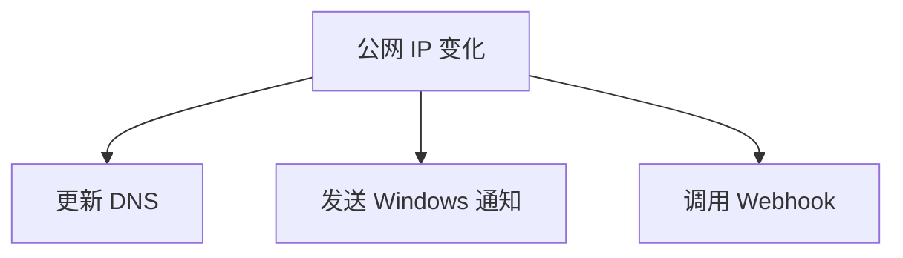
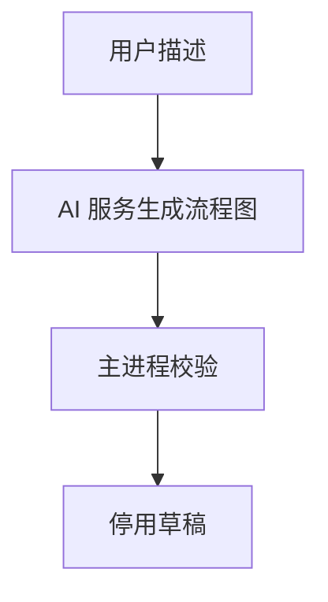
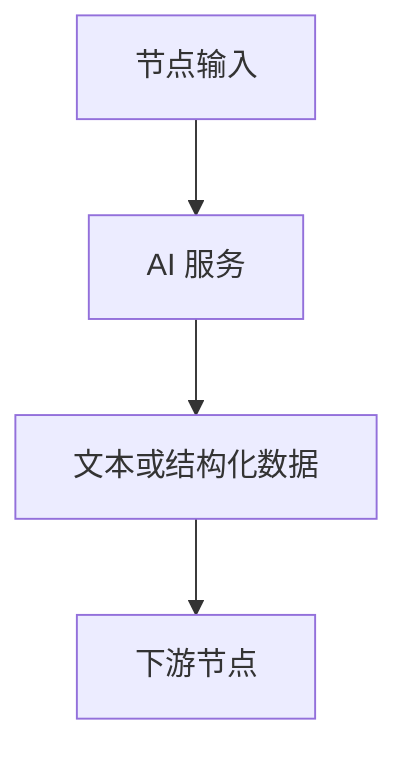

# KHooks 整体架构

KHooks 是以本机事件为入口的桌面自动化工具。用户在画布上手动编排流程，或由 AI 生成草稿，再通过触发器、条件和动作节点响应事件。任务在本机执行，用户可以从运行记录追踪实际经过的路径和节点结果。

## 子系统与数据流

关掉窗口后，Electron 主进程通过系统托盘继续运行。渲染进程负责编辑、启停、手动运行和查看记录，通过 preload IPC 访问主进程。主进程校验来自界面的操作，管理流程定义、触发器生命周期、任务执行和本地数据。

总图展示桌面界面、后台进程和本地存储之间的关系。[当前实现](#当前实现)记录已交付的能力。

## 触发与调度

触发器负责判断事件是否发生，并提交包含来源、类型和载荷的事件。调度器按目标工作流及其忙碌策略接收事件，为任务绑定原始载荷和当时的工作流快照。运行器从快照中的触发节点开始，将事件载荷作为该节点的输出。新增本机事件源沿用这一入口，例如将文件变化转换成可供下游引用的事件字段。

同一工作流最多有一次活跃运行。工作流内的节点并行由运行器管理。

| 忙碌策略 | 新事件到达 | 应用重启 |
| --- | --- | --- |
| 跳过 | 当前运行结束前，跳过新事件。已有流程默认沿用此策略。 | 恢复触发器调度。中断的运行保留记录。 |
| 排队 | 按接收顺序持久入队，同一工作流串行取用。 | 用原事件和流程快照从触发器重跑中断任务，记录为同一任务的新尝试，再处理后续排队任务。 |
| 中断当前，运行最新 | 请求取消当前运行，停止调度后续节点。等待期间只在当前会话保留最新事件，当前运行退出后再启动它。 | 恢复触发器调度。中断的运行保留记录，等待中的事件随会话结束而丢弃。 |

已发出的外部动作可能在取消后完成。排队模式重跑时，已经发出的 HTTP 请求或通知也可能再次执行。持久队列覆盖应用已经接收的事件，应用退出期间能否补收事件取决于事件来源。

## 工作流执行

- 可运行的工作流从唯一触发器出发，其余节点各有一个入口，且都能从触发器到达。连线禁止形成环路。单个出口的分支数以及工作流的节点数、连线数均无固定上限。
- 普通节点和触发器的出口会并行启动所有相连的下游节点。条件节点只启动命中出口的全部分支。公网 IP 变化产生一次运行，所有分支都可按节点标识引用该次触发携带的 IP 数据。
- 每次运行使用自己的流程快照和节点输出。分支中的节点可以引用本路径上的上游输出。运行记录保存实际执行的节点和经过的连线，正常运行会等所有已启动的分支结束后标记为成功。
- 执行中的节点失败时，本次运行判定失败。运行器停止调度后续节点并收尾已启动的动作，然后结束本次运行。普通失败和因应用退出而中断是不同的运行结果，排队恢复针对后者。

## 工作流编辑与复用

- 触发器和处理节点可设置自定义名称。画布展示名称和节点类型，名称留空时标题显示节点类型。节点身份和字段引用由工作流图内的节点标识决定。
- 流程列表可将已保存的定义复制为独立的停用流程。副本保留节点、布局、连线和图内标识，触发器状态与运行记录按新流程独立管理。
- 画布右键菜单可删除所选节点和连线，多选时可批量删除。启用中的流程保留另存组件入口，删除需先停用流程。
- 用户可从单个节点的右键菜单将配置另存到本地组件库，供各流程复用。组件保存配置快照，添加时以组件名称和新的节点标识创建独立节点。上游字段绑定在添加时清除，由用户连线后重新选择。触发器组件遵循每条流程最多一个触发器的规则。

## 本地状态与运行记录

本地存储管理工作流定义、触发器状态、排队任务及运行记录。持久入队及任务状态变更具有事务边界。任务从待运行转为执行中时，在同一事务内关联新的运行尝试。任务保留原始事件和流程快照，供重启时恢复。

运行记录关联逻辑任务、运行尝试和用于追踪的流程快照，展示本次经过的路径、节点结果和失败原因。历史详情使用该次运行的快照展示，编辑后的工作流定义只影响后续接收的任务。

## AI 编排与执行

### 编排助手

编排助手将用户提交的描述和支持的节点约定发给用户配置的 AI 服务。主进程校验模型返回的流程图，并保存为停用草稿。用户在同一画布审阅或编辑草稿，再决定手动运行或启用。

### AI 节点

AI 节点由用户在流程中显式配置模型和输入。节点运行时向所选服务发送配置指定的输入，返回文本或结构化数据，作为该节点的输出。后续动作由图上的连线和节点配置决定。

## 当前实现

| 能力 | 当前行为 |
| --- | --- |
| 后台触发 | 关窗后通过托盘继续运行。支持手动、定时和公网 IP 变化。后台轮询和使用已保存站点配置的手动运行都会记录最新检测结果，并将采纳的 IPv4 持久化为基线。变更站点配置后重新建立基线，后台轮询采纳的地址发生变化时触发流程。移除已下线站点后，若流程没有剩余查询站点，自动停用该流程。 |
| 调度 | 同一流程的自动调度在忙碌时跳过，手动运行遇到忙碌会报错。持久队列和取消后运行最新事件属于目标设计。 |
| 流程图 | 按[工作流执行](#工作流执行)规则并行运行分支。现有节点可设置数据、延时、发送 HTTP 请求或 Windows 通知。 |
| 本地数据与记录 | 用户数据目录中的 JSON 文件通过串行原子写入保存流程、组件、触发器状态、设置和运行记录。运行详情从保存的流程快照显示已执行的节点和连线。启动时将遗留的运行中记录标记为中断，自动重跑属于目标设计。 |
| AI | 配置 OpenAI 兼容服务后，可以生成停用草稿。AI 服务密钥由主进程通过 Electron `safeStorage` 加密保存。AI 执行节点属于目标设计。 |
| 应用更新 | Windows 安装版从 GitHub 正式 Release 检查更新。用户手动检查时可看到当前已是最新版，或确认安装新版。确认后自动下载、安装并重启应用。 |

现有行为见[工作流规则](../../src/shared/workflow.ts)、[主进程入口](../../src/main/index.ts)、[运行器](../../src/main/engine.ts)和[本地存储](../../src/main/storage.ts)。
